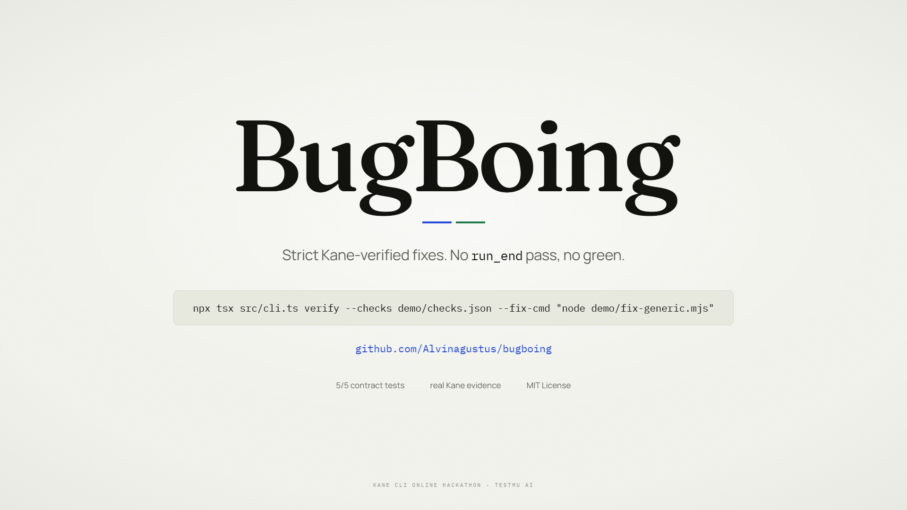

# BugBoing

**Fail. Boing. Fix. Verify.**  
BugBoing is a strict Kane-verified CLI wrapper for AI fix loops. It can run a fixer after a browser failure, but it turns green **only** when Kane CLI emits a passing `run_end`. Fixer exit `0`, missing verdicts, and unparseable output are never treated as success.

> Hackathon: KaneCLI Online Hackathon (TestMu AI). Built for web verification with Kane CLI as the load-bearing verification engine.



## Problem

AI coding agents can edit code fast, but they often miss the last mile: *did the fix actually work in a real browser?* A fixer can exit `0`, print "done", or patch the wrong thing — and you still don't have browser proof. BugBoing closes that gap by making Kane CLI the only pass/fail oracle.

## How It Works

1. **Run** - BugBoing executes checks via `kane-cli run ... --headless --agent`.
2. **Catch** - It parses Kane NDJSON `run_end` for status, reason/result codes, evidence, and Test Manager link.
3. **Boing** - On a **Kane-confirmed application issue** (`verdict.confirmed == true` and `verdict.family == "application_issue"`), it invokes `--fix-cmd` with a structured failure payload on stdin (JSON): the repair packet (`suggestion`, `culpritStep`, `rootCause`), the scope contract, and the raw `run_end`.
4. **Guard** - With the default scope guard, every edit outside the allowed paths is reported and reverted before the next Kane run; `checks.json` is restored even in `warn` mode, and `off` disables the guard.
5. **Verify** - It reruns the same Kane check. Only a Kane `run_end` with `status:"passed"` becomes green. Missing/unparseable `run_end` becomes `unverified` — never green.

Infrastructure noise is not a bug: unconfirmed verdicts, non-application families, and runs with no verdict never reach the fixer, and `--max-credits` stops the loop before spending credits it was not authorized to spend.

```text
checks.json ──> BugBoing ──> kane-cli run (--headless --agent)
                   │                    │
                   │              NDJSON run_end
                   │         (status/evidence/test_url)
                   │                    │
                   ├── pass ────────────┴──> report + exit 0
                   │
                   └── fail ──> confirmed application issue?
                                      │ yes                    │ no
                                      ▼                        ▼
                             fix-cmd (stdin JSON)      stop, not green
                                      │
                             scope guard (revert)
                                      │
                                      └──> rerun Kane check (boing!)
```

## Why Kane CLI Is Load-Bearing

BugBoing does **not** replace browser verification. Kane CLI is the only pass/fail oracle:
- Runs real browser objectives in natural language.
- Produces structured machine-readable NDJSON (`run_end`, result/reason codes, summary, context).
- Produces evidence packs and Test Manager share links.
- Catches real failures (e.g. assertion/confirmed product bug) that become the fix payload.

Without Kane CLI, BugBoing has no trusted pass/fail signal.

## Verification Contract (the differentiator)

This is the core of BugBoing. The loop pattern is crowded; the strict verdict contract is the point.

| Case | BugBoing result | Why |
|---|---|---|
| Kane `run_end.status == "passed"` | **GREEN / VERIFIED** | Real Kane verdict |
| Kane `run_end.status != "passed"` | **NOT GREEN** | Real Kane failure |
| Fixer exits `0`, but no Kane pass | **NOT GREEN** | Fixer exit code is not proof |
| Missing / unparseable `run_end` | **UNVERIFIED / NOT GREEN** | No verdict, no trust |
| `verdict.confirmed != true` or `family != "application_issue"` | **NOT GREEN, fixer not run** | Infra/auth/unconfirmed noise is not an app bug to patch |
| Fixer edits outside `--allow-fix` | **edits reverted, then rerun** | `revert` restores/deletes them; `checks.json` is restored in every mode |

The report makes this machine-visible:

```json
{
  "contract": { "rule": "no_kane_pass_no_green", "version": 1, "enforced": true },
  "checks": [{
    "passed": false,
    "kaneVerified": false,
    "verificationSource": "none",
    "trust": "unverified_missing_run_end",
    "trustReason": "Kane did not emit a run_end verdict; BugBoing refuses to treat this as green."
  }]
}
```

## Quick Start

### Prerequisites
- Node.js >= 20
- Kane CLI installed and authenticated (`kane-cli login`, `kane-cli whoami`)
- Windows note: use `kane-cli.cmd` if PowerShell script execution policy blocks `.ps1` wrappers.

### Install

```bash
git clone https://github.com/Alvinagustus/bugboing
cd bugboing
npm install   # runs prepare -> builds dist/cli.js
```

### Run the demo (golden path)

```bash
npm run demo
```

This resets the demo fixture, starts a local server, runs BugBoing with a generic payload-driven fixer (`demo/fix-generic.mjs`), and writes `demo/report.json`.

Expected: attempt 1 fails because Kane catches `BugBoing Demoo` != `BugBoing Demo`, the fixer consumes the failure JSON from stdin and patches `demo/index.html`, attempt 2 passes only after Kane `run_end` reports `passed`.

**Real agent cookbook loops** (Kane fail → real coding agent → Kane rerun pass):
- [`examples/real-agent-loop/`](./examples/real-agent-loop/) — runtime DOM heading bug, fixed by OpenCode CLI.
- [`examples/inventory-filter/`](./examples/inventory-filter/) — "In stock only" filter state/logic bug, fixed by OpenCode (`iceman-free`).
- [`examples/profile-save/`](./examples/profile-save/) — required-name validation bug, fixed by Hermes (Nous Portal, `meituan/longcat-2.5:free`).

**Other evidence:** [`examples/checkout-bug/`](./examples/checkout-bug/) (business-logic checkout total, deterministic fixer) and [`examples/checkout-public/`](./examples/checkout-public/) (same checkout defect verified against a public GitHub Pages URL with public Kane Test Manager links).

Manual run:

```bash
node demo/serve.mjs
# in another terminal
node dist/cli.js verify --checks demo/checks.json --fix-cmd "node demo/fix-generic.mjs" --max-attempts 2 --kane-cmd kane-cli.cmd --report demo/report.json
# dev fallback: npx tsx src/cli.ts verify ...
```

## Checks Format

`checks.json`:

```json
[
  {
    "name": "heading-check",
    "url": "http://127.0.0.1:4173",
    "objective": "Assert the h1 heading text is exactly 'BugBoing Demo'. Fail if the heading is different.",
    "timeoutSeconds": 120,
    "maxSteps": 50,
    "fixPaths": ["demo/index.html"]
  }
]
```

`fixPaths` (optional) narrows the scope guard for that check; paths are relative to the directory BugBoing runs in. When neither `fixPaths` nor `--allow-fix` is set, BugBoing allows the checks file's directory (or the whole workspace when the checks file sits at the root), and says so in the log.

## Fixer Interface (agent-agnostic, not the novelty)

The stdin fixer interface is useful plumbing, not the headline. Similar agent-cmd/stdin patterns exist in other tools; BugBoing's value is that **the fixer never decides green**.

`--fix-cmd` receives structured JSON on stdin:

```json
{
  "tool": "bugboing",
  "contract": { "rule": "no_kane_pass_no_green", "version": 1 },
  "check": { "name": "...", "url": "...", "objective": "..." },
  "attempt": 1,
  "maxAttempts": 2,
  "scope": { "allowed": ["demo/**"], "checksFile": "demo/checks.json" },
  "repair": {
    "suggestion": "Fix the heading text and rerun the check.",
    "culpritStep": "0-3",
    "rootCause": "heading text mismatch",
    "bugTitle": "Heading mismatch",
    "category": "ui_data_defect",
    "severity": "minor"
  },
  "result": {
    "status": "failed",
    "reason": "...",
    "trust": "kane_verified_fail",
    "kaneVerified": false,
    "verificationSource": "kane_run_end",
    "verdict": { "confirmed": true, "family": "application_issue" },
    "testUrl": "...",
    "rawRunEnd": { "...": "..." }
  }
}
```

The fixer can be any command that reads stdin JSON and attempts a repair. After it exits — even with exit `0` — BugBoing reruns Kane.

Examples:

```bash
# Generic payload-driven fixer (included, proves the contract)
--fix-cmd "node demo/fix-generic.mjs"

# Agent CLI examples (templates - adapt to your agent)
--fix-cmd "opencode run 'Fix the bug using the BugBoing JSON on stdin'"
--fix-cmd "claude -p 'Read BugBoing failure JSON from stdin and fix the issue'"
```

## CLI

```text
bugboing verify --checks <checks.json> [--fix-cmd <cmd>] [--max-attempts <n>] [--report <file>]
                [--kane-cmd <cmd>] [--kane-timeout <s>] [--max-credits <n>]
                [--allow-fix <globs>] [--scope-guard off|warn|revert]
```

- `--kane-timeout` is a hard kill deadline for the whole Kane process tree (default: the check's `timeoutSeconds` + 60s). On timeout the check is `unverified`, never green.
- `--max-credits` stops before the next Kane run or fixer once that many credits have been consumed. The report records `credits.consumed`, `credits.limit`, and `credits.exhausted`.
- `--allow-fix` is a comma-separated glob list the fixer may change (default: the checks file's directory). `check.fixPaths` adds per-check paths.
- `--scope-guard` is `revert` (default), `warn`, or `off`. `revert` restores modified files, deletes files the fixer created outside scope, and restores deleted files. `warn` reports out-of-scope edits without touching them, but still restores `checks.json` so a weakened check cannot persist. This is a guardrail, not an OS sandbox.

Exit codes:
- `0` - all checks passed (after retries if any)
- `1` - at least one Kane-verified failure (red), including after a fix attempt
- `2` - BugBoing could not obtain a Kane verdict (missing `run_end`, timeout, credit budget), or a tool/config/runtime error

## Evidence

- `demo/report.json` - real Kane golden-path report (fail → fix → pass). It was captured before the gating/scope work, so it is `v0.2.0` and has `contract`, `trust`, `kaneVerified`, `verificationSource`, `rawRunEnd`; current reports are `v0.3.0` and add `credits`, `verdict`, `fixDecision`, and `scope`.
- `examples/real-agent-loop/` - real OpenCode CLI loop: runtime heading bug, agent uses `glob`/`read`/`edit`, Kane reruns to pass.
- `examples/inventory-filter/` - real OpenCode (`iceman-free`) loop: In stock only filter fails to hide out-of-stock items; agent fixes filter logic; Kane reruns to pass.
- `examples/profile-save/` - real Hermes (Nous Portal, `meituan/longcat-2.5:free`) loop: empty required Name saved as "Saved!"; agent adds validation; Kane reruns to pass.
- `examples/checkout-bug/` - business-logic defect: discount shown but total stays $100.00; Kane catches `functional_defect`/`major`; deterministic fixer; Kane reruns to pass.
- `examples/checkout-public/` - same checkout defect verified against a **public GitHub Pages URL** (`https://alvinagustus.github.io/bugboing/checkout-public/`), with public Kane Test Manager `test_url` evidence.
- `tests/contract.test.ts` - contract tests proving: pass is green only on Kane `run_end` pass; exit `0` without `run_end` is NOT green; missing/unparseable/non-`run_end` verdict is NOT green.
- `tests/loop.test.ts` - loop test proving fixer is invoked, Kane reruns, and green happens only after a Kane `run_end` pass.
- `tests/gating.test.ts` - verdict gating (`confirmed` + `application_issue`), repair-packet payload, and `--max-credits`; the refusal cases assert the fixer did **not** run.
- `tests/scope.test.ts` - scope guard: allowed edits survive, out-of-scope edits are reverted or deleted, `checks.json` is restored, and `warn` mode reports without touching files.
- `tests/timeout.test.ts` + `tests/proc.test.ts` - a check whose Kane command hangs (and ignores `SIGTERM`) is killed with its whole process tree; BugBoing exits `2` with `unverified_missing_run_end` instead of hanging on open pipes.
- `demo/fix-generic.mjs` - deterministic payload-driven fixer demonstrating the stdin JSON interface (not a real agent; see the three real-agent cookbook loops above).

## Tests

```bash
npm test
```

## Known Limitations / Honest Positioning

- **Crowded pattern.** Fail→fix→rerun loops and stdin-driven agent commands already exist in the ecosystem. BugBoing does **not** claim novelty there.
- **Narrow proof.** BugBoing's value is the strict, testable verdict contract: no Kane `run_end` pass = no green. That contract is enforced in code and covered by contract tests.
- **Demo fixers are scoped.** The golden-path demo uses a deterministic payload-driven fixer for reliability. Three real-agent cookbook loops are committed (`real-agent-loop`, `inventory-filter`, `profile-save`), each one fixture/one run — evidence that agent↔Kane communication works, not a benchmark of agent quality.
- **Scope guard is best-effort.** It snapshots the workspace, compares hashes after the fixer, and restores out-of-scope changes. It skips `.git`, `node_modules`, `.next`, `.cache`, `.turbo`, and `.testmuai`, and it is not an OS-level sandbox; use `--allow-fix` and a disposable checkout for untrusted agents. The snapshot copies workspace files per fix attempt, so very large repos pay I/O cost.
- **Kane objective quality matters.** Vague objectives may produce weak assertions.
- **Operational dependency.** Requires Kane CLI/TestMu AI availability and credits. Windows PowerShell script policy may require `.cmd` wrappers.
- **Cut for scope.** No parallel checks, MCP server, HTML dashboard, or 0-credit replay regression guard (investigated as a possible gap; not shipped).

## License

MIT. See [`LICENSE`](./LICENSE).
